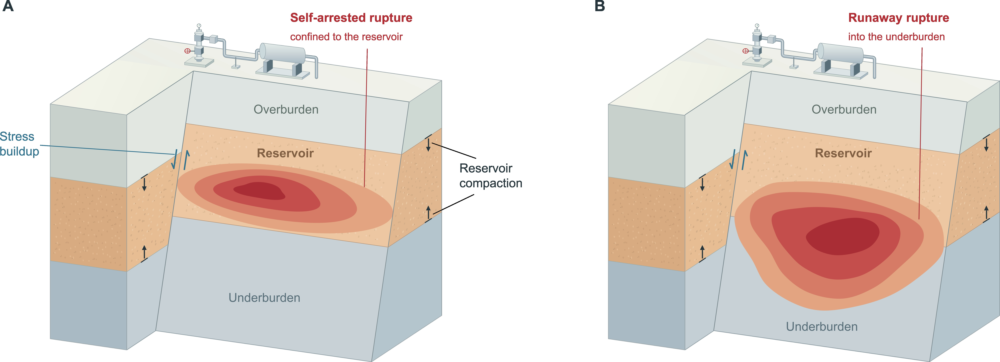
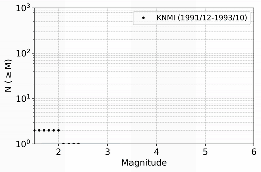
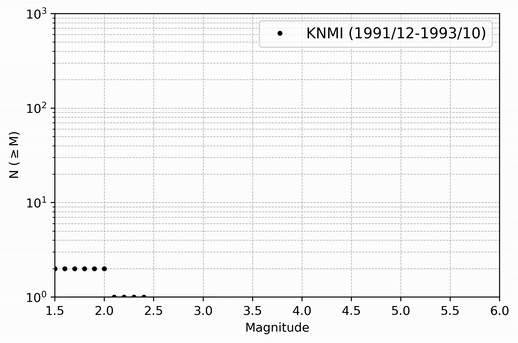

# Maximum earthquake magnitudes in the Groningen gas field
This repository provides the code for the PNAS paper

**Conditions for runaway ruptures during reservoir operations: Magnitude–frequency distribution implications and application to Groningen** 

by Qian Shi\*, Alexis Sáez, Linxuan Li, Kyungjae Im, Stephen Bourne, Jan van Elk, and Jean-Philippe Avouac\*

*Proceedings of the National Academy of Sciences* **123** (48), e2625955123 (2026), [doi:10.1073/pnas.2625955123](https://doi.org/10.1073/pnas.2625955123) ([Supporting information](https://www.pnas.org/doi/10.1073/pnas.2625955123#supplementary-materials)).

## Introduction

Production-induced earthquake ruptures can arrest within the reservoir or propagate into the underburden (see below). We use linear elastic fracture mechanics (LEFM) with model parameters constrained by measurements to quantify the probability of such a runaway rupture.

Our model (blue) reproduces the spatiotemporal evolution of the observed magnitude–frequency distributions (black).

| [Movie S1](github/MovieS1.mp4) | [Movie S2](github/MovieS2.mp4) |
| :---: | :---: |
|  |  |

## Dependencies

The notebooks use **Python 3.11.4**.

- `numpy`
- `scipy`
- `pandas`
- `matplotlib`
- `tqdm`
- `joblib`
- `imageio`
- `imageio-ffmpeg`

The [Figure 1A map script](code/Fig_1A.gmt) uses **GMT 6**.

## Contact

For questions about the code or data, contact **Qian Shi** at `qshi2 at caltech.edu`.
